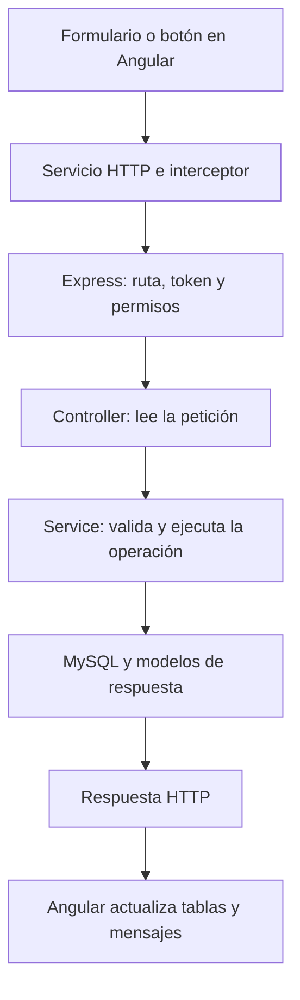

# CoffeERP

Sistema académico para administrar una cafetería con Angular, Express y MySQL. Incluye ventas, compras y proveedores, inventario, recursos humanos y finanzas. La pantalla de ventas integra PayPal Sandbox y genera una factura XML académica que se puede descargar o enviar por correo con Brevo.

Este documento explica cómo se ejecuta el sistema, cómo recorre una petición las distintas capas y cómo se aplican la autenticación y los permisos.

## Organización y nombres de archivos

El frontend organiza cada componente en su carpeta de módulo y el backend conserva sus carpetas por responsabilidad. Los archivos usan el nombre del módulo en español y una terminación que identifica su responsabilidad:

| Terminación      | Ejemplo                                        | Responsabilidad                                                 |
| ---------------- | ---------------------------------------------- | --------------------------------------------------------------- |
| `.routes.js`     | `back-erp/router/productos.routes.js`          | Define método HTTP, endpoint, filtros de acceso y controlador.  |
| `.controller.js` | `back-erp/controllers/productos.controller.js` | Lee la petición, llama al servicio y prepara la respuesta HTTP. |
| `.service.js`    | `back-erp/services/productos.service.js`       | Valida datos y ejecuta consultas y reglas de negocio.           |
| `.model.js`      | `back-erp/models/producto.model.js`            | Convierte una fila de MySQL en propiedades en español.          |
| `.service.ts`    | `coffeERP/src/app/services/api.service.ts`     | Servicio de Angular para comunicarse con el servidor.           |
| `.model.ts`      | `coffeERP/src/app/models/producto.model.ts`    | Interfaces que describen los datos usados por Angular.          |
| `.routes.ts`     | `coffeERP/src/app/app.routes.ts`               | Relaciona direcciones del navegador con pantallas y permisos.   |

`app.js` inicia Express. `config/baseDatos.js` abre la conexión a MySQL. `middleware/autenticacion.js` verifica sesiones y permisos; `middleware/errores.js` transforma fallos en respuestas JSON. `lib/validacion.js` comparte validaciones y `lib/transaccion.js` confirma o revierte operaciones relacionadas.

En `coffeERP/src/app/componentes` están `autenticacion`, `compras`, `empleados`, `finanzas`, `menu`, `productos` y `ventas`, con `checkout` dentro de ventas. Cada componente conserva su TS, HTML y CSS y tiene carpetas `model` y `servicios` para sus archivos específicos, uno por modelo o servicio. Los guards siguen en `src/app/guards`. Los modelos y servicios compartidos permanecen en `src/app/models` y `src/app/services`: usuario, sesión, módulos, catálogo de productos, autenticación, HTTP y estado de formularios. El componente raíz `app.ts`, con `app.html` y `app.css`, coloca el menú y la pantalla activa. La pantalla de inventario mantiene `/inventario` y empleados mantiene `/rrhh`.

El código fuente del frontend está en `public` y `src`, junto con sus archivos de configuración. `node_modules`, `dist` y `.angular` son dependencias o resultados generados y están excluidos de Git. `npm ci` reinstala las dependencias; Angular genera sus carpetas de trabajo al ejecutarse.

Los comentarios del código están EN MAYUSCULAS Y SIN ACENTOS. Los nombres de las funciones, los campos públicos y los endpoints permanecen en español. Las columnas SQL existentes y las claves que exigen las librerías y proveedores conservan sus nombres.

## Estructura del frontend

| Carpeta o archivo                       | Para qué sirve                                                                              |
| --------------------------------------- | ------------------------------------------------------------------------------------------- |
| `src/main.ts`                           | Inicia Angular en el navegador.                                                             |
| `src/app/app.ts`, `app.html`, `app.css` | Componente raíz que muestra el menú con una sesión activa y la pantalla seleccionada.       |
| `src/app/app.config.ts`                 | Registra router, HTTP e interceptor de autenticación.                                       |
| `src/app/app.routes.ts`                 | Define rutas, carga de componentes, roles y módulos requeridos.                             |
| `src/app/componentes`                   | Pantallas con TS, HTML, CSS y carpetas locales `model` y `servicios`.                       |
| `src/app/guards/auth.guard.ts`          | Recupera o comprueba la sesión antes de entrar.                                             |
| `src/app/guards/role.guard.ts`          | Comprueba el rol y el módulo declarados en `data` de la ruta.                               |
| `src/app/models`                        | Modelos compartidos: usuario, sesión, módulos y producto.                                   |
| `src/app/services`                      | Servicios compartidos: HTTP, autenticación, interceptor, productos y estado de formularios. |
| `src/pruebas`                           | Pruebas de guards, menú y checkout, separadas de los componentes.                           |

La aplicación funciona en el navegador y consulta el backend Express por `/api`. La [guía de Angular](coffeERP/README.md) muestra el árbol actualizado y explica cada componente, servicio, modelo y archivo de configuración.

## Cómo recorre una operación el sistema



Por ejemplo, al guardar un producto:

1. `componentes/productos/productos.component.ts` toma los datos del formulario, convierte el precio en pesos a centavos y llama a `ProductosService.crear(datos)`.
2. `ProductosService` delega el transporte en `services/api.service.ts`, que agrega `/api` y envía `POST /api/productos` con el cuerpo JSON.
3. El interceptor de `services/autenticacion.interceptor.ts` agrega el token de la sesión al encabezado `Authorization`.
4. En `app.js`, `verificarToken` comprueba la sesión. Después, `router/productos.routes.js` aplica `permitirModulo('INVENTARIO')`.
5. El controlador `crear` recibe `solicitud.body`, llama al servicio y espera el resultado.
6. `services/productos.service.js` valida nombre, precio y mínimo. Ejecuta una consulta parametrizada: los valores se envían separados de la instrucción SQL.
7. El controlador devuelve `201` con el ID creado. Angular limpia el formulario y vuelve a consultar el catálogo.

Al consultar productos, el servicio transforma las filas SQL con `Producto` antes de devolverlas. Por ejemplo, la columna `price_cents` se expone como `precioCentavos`. Los modelos del backend representan datos; las consultas se ejecutan desde los servicios. Las interfaces de Angular describen los campos esperados, pero no sustituyen las validaciones del servidor.

## Autenticación: comprobar quién inicia sesión

La autenticación empieza en `/iniciar-sesion` y funciona así:

1. Angular envía `correo` y `contrasena` a `POST /api/autenticacion/iniciar-sesion`. Esta ruta es pública porque todavía no hay token.
2. `autenticacion.controller.js` pasa las credenciales a `iniciarSesion` de `autenticacion.service.js`.
3. El servicio normaliza el correo y busca una cuenta activa en `users`.
4. `bcrypt.compare` compara la contraseña recibida con el hash guardado. La contraseña original no se almacena en la base.
5. Si coincide, `Usuario.paraCliente()` prepara un perfil sin el hash. El servidor firma un JWT con `JWT_SECRET`, el ID del usuario como sujeto y un vencimiento de una hora.
6. La respuesta contiene `{ token, usuario }`. El perfil incluye `id`, `nombre`, `correo`, `rol` y `modulos`.
7. Angular guarda el token en `sessionStorage` y el perfil en una señal. Esto conserva el acceso al recargar la misma pestaña sin guardar la contraseña.

Ejemplo del cuerpo de inicio de sesión:

```json
{
  "correo": "admin@example.test",
  "contrasena": "TU_CONTRASENA"
}
```

En las siguientes peticiones locales, el interceptor agrega:

```http
Authorization: Bearer <TOKEN>
```

`verificarToken` lee ese encabezado, comprueba la firma y el vencimiento y exige que el contenido tenga `id` y `rol`. Si es válido, lo guarda en `solicitud.usuario` para que los filtros y servicios conozcan la cuenta. Si falta el token, está vencido o no es válido, devuelve `401`.

El JWT está firmado; su contenido no está cifrado. Por eso el perfil no incluye la contraseña ni su hash, y `JWT_SECRET` permanece en el backend. El interceptor solo adjunta el token a URLs que empiezan con `/api/`; no lo envía al SDK de PayPal.

Al recargar Angular, `restaurarSesion()` usa el token guardado para consultar `GET /api/autenticacion/perfil`. Al cerrar sesión, Angular borra el token y el perfil y vuelve al acceso. No hay renovación automática ni lista de revocación de tokens: un token emitido vence al cumplirse su hora de duración. Los roles y módulos se toman del perfil firmado al iniciar sesión; los cambios posteriores de la cuenta se reflejan al obtener un token nuevo.

## Permisos: comprobar qué puede hacer la cuenta

El sistema aplica tres comprobaciones diferentes:

| Comprobación | Dónde se aplica                    | Qué decide                                                                     |
| ------------ | ---------------------------------- | ------------------------------------------------------------------------------ |
| Sesión       | `verificarToken`                   | Si la petición tiene una sesión válida.                                        |
| Rol o módulo | `permitirRoles` y `permitirModulo` | Si la cuenta puede ejecutar esa operación.                                     |
| Propietario  | Servicio de ventas                 | Si la venta pertenece al usuario que la solicita. ADMIN puede acceder a todas. |

`permitirRoles('ADMIN')` protege la creación de cuentas. `permitirModulo('INVENTARIO')`, por ejemplo, protege altas, ediciones y ajustes de productos. Una cuenta ADMIN supera los filtros de módulo; una cuenta CAJERO necesita tener el módulo solicitado en su lista.

| Operación                                              | ADMIN                                   | CAJERO                                    |
| ------------------------------------------------------ | --------------------------------------- | ----------------------------------------- |
| Consultar el catálogo de productos                     | Permitido con sesión                    | Permitido con sesión                      |
| Crear o editar productos y ajustar inventario          | Permitido                               | Requiere INVENTARIO                       |
| Consultar o registrar proveedores y compras            | Permitido                               | Requiere COMPRAS                          |
| Administrar empleados y registrar salarios             | Permitido                               | Requiere RRHH                             |
| Consultar o registrar movimientos financieros          | Permitido                               | Requiere FINANZAS                         |
| Registrar y consultar ventas                           | Todas las ventas                        | Requiere VENTAS; consulta solo sus ventas |
| Capturar, cancelar o consultar la factura de una venta | Cualquier venta permitida por su estado | Requiere VENTAS y ser propietario         |
| Crear cuentas de acceso                                | Permitido                               | No permitido                              |

Al registrar una cuenta, el servicio acepta los módulos VENTAS, COMPRAS, INVENTARIO, RRHH y FINANZAS. ADMIN recibe todos. Para CAJERO se filtran los nombres desconocidos; si no queda ningún módulo válido, el servicio asigna VENTAS. El formulario pide elegir al menos uno.

En Angular, `authGuard` comprueba o restaura la sesión y `roleGuard` revisa los roles y el módulo de cada ruta. El servicio de autenticación expone `estaAutenticado()`, `tieneRol()`, `tieneModulo()` e `inicio()`. El menú muestra los enlaces permitidos. La autorización también se aplica en Express: escribir otra dirección o enviar una petición manual no evita sus filtros. Un usuario con token válido pero sin permiso recibe `403`.

`cors()` permite peticiones desde otros orígenes; el acceso a los datos lo deciden el token y los permisos.

## Métodos HTTP y métodos del código

Los métodos HTTP indican qué clase de petición envía Angular:

| Método HTTP | Uso actual                                                                 | Método de Angular                                            | Ejemplo                |
| ----------- | -------------------------------------------------------------------------- | ------------------------------------------------------------ | ---------------------- |
| GET         | Consultar datos o descargar una factura.                                   | `ServicioApi.obtener()` o `VentasService.descargarFactura()` | `GET /api/productos`   |
| POST        | Crear registros o ejecutar acciones como iniciar sesión, pagar y cancelar. | `ServicioApi.crear()`                                        | `POST /api/compras`    |
| PUT         | Actualizar un producto o un empleado por su ID.                            | `ServicioApi.actualizar()`                                   | `PUT /api/empleados/3` |

Actualmente no hay endpoints DELETE ni PATCH. Los productos y empleados se desactivan enviando `activo: false` mediante PUT. El método HTTP y la ruta se evalúan juntos: GET `/api/productos` consulta el catálogo; POST sobre la misma ruta intenta crear un producto y requiere INVENTARIO.

`solicitud.params.id` contiene el ID de la dirección y `solicitud.body` contiene el JSON enviado. En controladores y servicios, métodos como `crear`, `actualizar`, `pagarNomina` o `capturar` ejecutan la operación concreta. Las rutas deciden cuál llamar.

Códigos de respuesta más utilizados:

| Código    | Significado en el sistema                                                        |
| --------- | -------------------------------------------------------------------------------- |
| 200       | Consulta o acción completada.                                                    |
| 201       | Nuevo registro creado.                                                           |
| 400       | Datos incompletos, con formato incorrecto o fuera del rango permitido.           |
| 401       | Credenciales incorrectas o token ausente, inválido o vencido.                    |
| 403       | La cuenta no tiene permiso o la venta pertenece a otra cuenta.                   |
| 404       | Ruta o registro no encontrado.                                                   |
| 409       | Conflicto: duplicado, existencias reservadas o estado incompatible de una venta. |
| 500       | Error interno; la respuesta oculta consultas SQL y detalles sensibles.           |
| 502 / 503 | Fallo del proveedor externo o configuración necesaria no disponible.             |

Los errores JSON contienen `mensaje`. El servicio `EstadoFormularioService`, con una instancia por pantalla, muestra ese mensaje, mantiene el estado `ocupado` durante una operación y evita envíos repetidos mientras termina la petición.

La [documentación del backend](back-erp/README.md) enumera todos los endpoints y los principales métodos de negocio. La [documentación de Angular](coffeERP/README.md) describe formularios, servicios y navegación.

## Proceso de cada módulo

- **Inventario:** el catálogo guarda nombre, precio, mínimo y estado. Los ajustes registran una cantidad positiva o negativa y su motivo. El servidor impide retirar unidades reservadas.
- **Compras:** se registran mercancía recibida y pagada. Una transacción guarda la compra, sus productos, las entradas de inventario y el egreso en finanzas.
- **Recursos humanos:** los expedientes laborales son independientes de las cuentas de acceso. Al registrar un salario se toma el importe guardado del empleado activo. Una clave única impide repetir empleado y mes; el pago y su egreso se guardan juntos.
- **Ventas:** el servidor calcula el total con precios de MySQL y reserva unidades. La API permite efectivo y PayPal; la pantalla actual abre PayPal Sandbox. El pago confirmado descuenta existencias, libera reservas y registra un ingreso único.
- **Finanzas:** muestra los últimos 200 movimientos y los totales de todo el historial. Permite agregar ingresos o gastos manuales. Los importes se guardan como centavos enteros.

En PayPal, aprobar la ventana de pago aún requiere capturar y verificar el cobro en el backend. Se revisan la orden, el estado COMPLETED, la moneda MXN y el importe. Una operación incierta queda en REVISION para consultarla de nuevo sin liberar sus reservas. La cancelación revisa el estado del proveedor antes de intentar liberar productos.

Después del cobro se intenta enviar la factura XML. Si falla el correo, la venta permanece pagada y se puede descargar el archivo o reintentar su envío. ENVIADA indica que el proveedor aceptó el correo; no confirma la entrega en la bandeja del cliente. El comprobante es académico y no tiene validez fiscal.

## Preparación y ejecución local

Credenciales del administrador de prueba para iniciar sesión:

- **Correo:** `admin.prueba@coffe.test`
- **Contraseña:** `AdminCafe2026!`

Requiere Node.js compatible con Angular 21 (por ejemplo, Node 22.12+ o 24), npm y MySQL. Para comprobar pagos y correo también requiere credenciales de PayPal Sandbox y Brevo.

1. Crea la base y un usuario con permisos. Desde un cliente MySQL:

   ```sql
   CREATE DATABASE coffe_erp_exam CHARACTER SET utf8mb4 COLLATE utf8mb4_unicode_ci;
   CREATE USER 'coffe'@'localhost' IDENTIFIED BY 'TU_CLAVE_MYSQL';
   GRANT ALL PRIVILEGES ON coffe_erp_exam.* TO 'coffe'@'localhost';
   ```

2. Desde la raíz del repositorio, importa las tablas en esa base:

   ```bash
   mysql -u root -p coffe_erp_exam -e "source back-erp/sql/schema.sql"
   ```

   El script crea tablas que falten. No cambia la estructura de tablas existentes.

3. Prepara el backend:

   ```powershell
   cd back-erp
   npm ci
   Copy-Item .env.example .env
   ```

   Completa `DB_HOST`, `DB_USER`, `DB_PASSWORD`, `DB_NAME`, `JWT_SECRET` y `PORT`. La conexión usa el puerto predeterminado de MySQL, 3306. `PORT` corresponde a Express; usa `3000` para coincidir con el proxy de Angular. Puedes generar un secreto con:

   ```bash
   node -e "console.log(require('node:crypto').randomBytes(32).toString('hex'))"
   ```

4. Crea el administrador inicial manualmente. Desde `back-erp`, genera un hash de una contraseña propia:

   ```bash
   node -e "console.log(require('bcryptjs').hashSync('TU_CONTRASENA',12))"
   ```

   En MySQL inserta la cuenta usando el hash generado:

   ```sql
   INSERT INTO users(name,email,password_hash,role,modules)
   VALUES ('Administrador','TU_CORREO','EL_HASH_GENERADO','ADMIN','VENTAS,COMPRAS,INVENTARIO,RRHH,FINANZAS');
   ```

   Las variables `ADMIN_EMAIL` y `ADMIN_PASSWORD` del ejemplo sirven como referencia de preparación; el arranque actual no crea la cuenta automáticamente. Las cuentas creadas desde el sistema requieren contraseñas de 10 a 72 caracteres, con mayúscula, número y símbolo.

5. Ejecuta `npm start` desde `back-erp`. En otra terminal, desde `coffeERP`, ejecuta `npm ci` y `npm start`. Abre `http://localhost:4200`; el proxy envía `/api` a `http://127.0.0.1:3000`.

Para integrar los proveedores, completa en `back-erp/.env`:

```dotenv
PAYPAL_BASE_URL=https://api-m.sandbox.paypal.com
PAYPAL_CLIENT_ID=TU_CLIENT_ID_SANDBOX
PAYPAL_CLIENT_SECRET=TU_SECRET_SANDBOX
BREVO_API_KEY=TU_CLAVE_API_BREVO
MAIL_FROM=tu-remitente-autorizado@example.com
```

Reinicia el backend después de cambiar `.env`. Las claves secretas permanecen en el servidor. La aplicación solo permite PayPal Sandbox.

## Verificación

Desde `coffeERP`, ejecuta `npm run build`. Para revisar el funcionamiento, inicia ambos proyectos y comprueba inicio de sesión, acceso por módulos, guardado de registros y cierre de sesión. Usa una cuenta CAJERO con permisos limitados para comprobar las respuestas 403 y la visibilidad del menú.

`npm test` desde `back-erp` comprueba el flujo PayPal con rutas, controladores y servicios reales, usando MySQL y el proveedor simulados. `npm test` desde `coffeERP` ejecuta nueve pruebas de acceso, roles y menú en `src/pruebas/guards.spec.ts`, y ocho pruebas del checkout y su servicio con el SDK simulado. Estas pruebas no realizan cobros ni envíos de correo y no equivalen a una validación con proveedores reales.

## Alcance actual

El checkout está en `coffeERP/src/app/componentes/ventas/checkout` y sigue el flujo de creación y captura del [SDK v6 de PayPal](https://developer.paypal.com/sdk/js/set-up/). Recibe el carrito y los datos reales de Ventas. `PayPalService` envía las órdenes a `/api/paypal/orden` y captura por el ID externo en `/api/paypal/capturar/:orderId`. La captura del checkout devuelve `orderId` y `captureId`, como el ejemplo de PayPal, además de `idVenta` y `estadoCorreo` para el historial y las facturas. El servidor conserva las ventas en MySQL, verifica permisos e importe y mantiene las reservas de pagos inciertos. Las rutas del historial de ventas siguen disponibles para verificar pagos y consultar facturas.

No incluye contabilidad de doble partida, impuestos, timbrado CFDI, devoluciones ni cobros de producción. La interfaz de compras captura un producto por operación; la API admite varios distintos. No libera automáticamente una reserva con pago incierto. Un reintento de correo puede duplicar el mensaje si el proveedor lo aceptó antes de perderse la respuesta.
