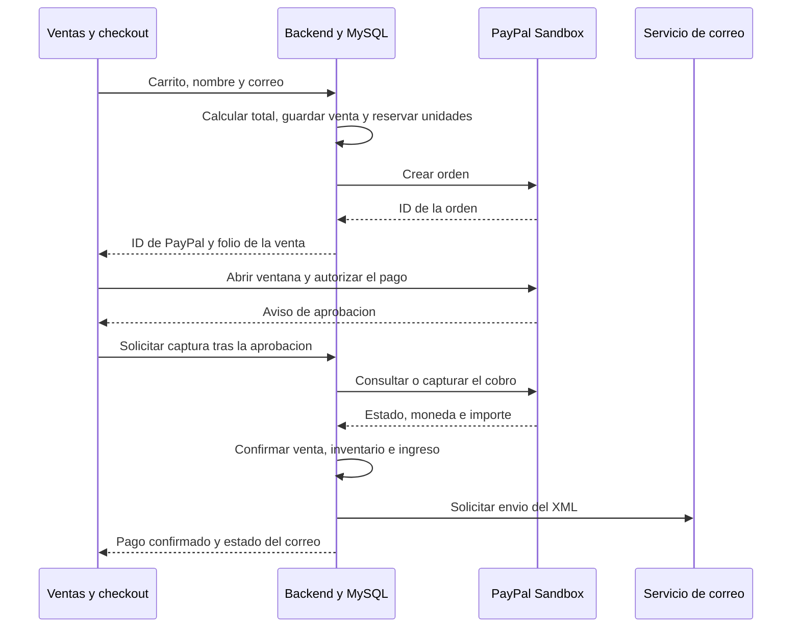

# Frontend Angular

La aplicación funciona en el navegador. Sus componentes presentan los formularios y tablas, los servicios consultan Express y los guards controlan la navegación. El backend aplica nuevamente los permisos y guarda los datos en MySQL.

La [guía principal](../README.md) explica la instalación y el proceso completo; la [guía del backend](../back-erp/README.md) enumera endpoints y reglas de negocio.

El **frontend** es la parte que ves en el navegador; el **backend** es el programa que recibe las solicitudes y trabaja con la base de datos. Una petición HTTP es un mensaje entre ambos: GET consulta información y POST envía datos para realizar una acción. Una ruta es la dirección a la que se manda ese mensaje.

Los tres procesos se explican en [Autenticación y permisos](#autenticación-y-permisos), [PayPal](#paypal-desde-el-carrito-hasta-el-pago-confirmado) y [Envío de correos](#envío-de-correos-la-factura-después-del-pago).

## Estructura

```text
src/
  app/
    app.config.ts
    app.css
    app.html
    app.routes.ts
    app.ts
    componentes/
      autenticacion/
        autenticacion.component.css
        autenticacion.component.html
        autenticacion.component.ts
        model/
        servicios/
      compras/
        compras.component.css
        compras.component.html
        compras.component.ts
        model/
          compra.model.ts
          proveedor.model.ts
        servicios/
          compras.service.ts
          proveedores.service.ts
      empleados/
        empleados.component.css
        empleados.component.html
        empleados.component.ts
        model/
          cuenta.model.ts
          empleado.model.ts
          nomina.model.ts
        servicios/
          cuentas.service.ts
          empleados.service.ts
          nomina.service.ts
      finanzas/
        finanzas.component.css
        finanzas.component.html
        finanzas.component.ts
        model/
          movimiento-contable.model.ts
          resumen-finanzas.model.ts
        servicios/
          finanzas.service.ts
      menu/
        menu.component.css
        menu.component.html
        menu.component.ts
        model/
        servicios/
      productos/
        model/
          movimiento-inventario.model.ts
        productos.component.css
        productos.component.html
        productos.component.ts
        servicios/
          inventario.service.ts
      ventas/
        checkout/
          checkout.component.css
          checkout.component.html
          checkout.component.ts
          model/
            configuracion-paypal.model.ts
            orden-paypal.model.ts
            paypal-global.model.ts
            sdk-paypal.model.ts
            sesion-paypal.model.ts
          servicios/
            paypal-sdk.service.ts
            paypal.service.ts
        model/
          producto-carrito.model.ts
          resultado-operacion-venta.model.ts
          resultado-pago.model.ts
          venta.model.ts
        servicios/
          ventas.service.ts
        ventas.component.css
        ventas.component.html
        ventas.component.ts
    guards/
      auth.guard.ts
      role.guard.ts
    models/
      modulo.model.ts
      producto.model.ts
      sesion.model.ts
      usuario.model.ts
    services/
      api.service.ts
      autenticacion.interceptor.ts
      autenticacion.service.ts
      estado-formulario.service.ts
      productos.service.ts
  index.html
  main.ts
  pruebas/
    ventas.spec.ts
  styles.css
public/
  favicon.ico
  hero.jpg
  fonts/
```

En `src/app` se conservan `componentes`, `guards`, `models` y `services`. Cada componente mantiene su TS, HTML y CSS, y agrupa sus archivos propios en `model` y `servicios`. Los modelos y servicios que usan varias pantallas permanecen en las carpetas generales. Ventas comparte su carrito y resultado de pago con el checkout; los archivos exclusivos de PayPal están dentro de `ventas/checkout`. Acceso y menú usan los archivos comunes, por lo que sus carpetas locales solo contienen marcadores `.gitkeep`. Las pruebas permanecen en `src/pruebas`.

## Archivos de inicio y configuración

| Archivo                        | Para qué sirve                                                                 |
| ------------------------------ | ------------------------------------------------------------------------------ |
| `src/index.html`               | Documento base: idioma, título, icono y elemento `app-root`.                   |
| `src/main.ts`                  | Inicia Angular con `App` y la configuración de la aplicación.                  |
| `src/styles.css`               | Colores, fuentes, formularios, tablas, botones y avisos compartidos.           |
| `src/app/app.ts`               | Componente raíz; importa el menú y el espacio donde se muestra la ruta activa. |
| `src/app/app.html`             | Muestra el menú cuando hay sesión y coloca el `router-outlet`.                 |
| `src/app/app.css`              | Reserva espacio para el menú y adapta el contenido a pantallas pequeñas.       |
| `src/app/app.config.ts`        | Registra router, cliente HTTP, interceptor y manejo de errores del navegador.  |
| `src/app/app.routes.ts`        | Declara direcciones, componentes, guards y datos de roles y módulos.           |
| `angular.json`                 | Configura desarrollo, compilación del navegador, recursos, estilos y pruebas.  |
| `package.json`                 | Dependencias y comandos `start`, `build`, `watch` y `test`.                    |
| `package-lock.json`            | Versiones exactas para reinstalar con `npm ci`.                                |
| `proxy.conf.json`              | Reenvía `/api` al backend en `http://127.0.0.1:3000` durante el desarrollo.    |
| `tsconfig.json`                | Opciones compartidas de TypeScript y comprobación estricta de plantillas.      |
| `tsconfig.app.json`            | Compila la aplicación y excluye las pruebas `.spec.ts`.                        |
| `tsconfig.spec.json`           | Compila las pruebas de Angular con tipos de Vitest.                            |
| `.editorconfig`, `.prettierrc` | Reglas de formato para el editor y Prettier.                                   |
| `.gitignore`                   | Excluye dependencias y archivos generados de Git.                              |
| `public/`                      | Icono, imagen del acceso y fuentes con su licencia; se copian al compilar.     |

## Componentes

Cada archivo `.component.ts` prepara los datos y atiende las acciones; su `.component.html` presenta formularios, botones y tablas; su `.component.css` contiene los estilos exclusivos del componente. Los componentes consultan servicios y no construyen los endpoints de negocio directamente.

| Carpeta en `componentes/` | Función                                                                                                                | Ruta o ubicación                    |
| ------------------------- | ---------------------------------------------------------------------------------------------------------------------- | ----------------------------------- |
| `autenticacion`           | Pide correo y contraseña; después del acceso abre el primer módulo permitido.                                          | `/iniciar-sesion`                   |
| `menu`                    | Muestra enlaces permitidos, módulo seleccionado, perfil y cierre de sesión.                                            | Dentro de `App`, cuando hay sesión. |
| `productos`               | Productos, precios, mínimos, existencias y ajustes de inventario.                                                      | `/inventario`                       |
| `compras`                 | Registro de proveedores y mercancía recibida y pagada; historial de compras.                                           | `/compras`                          |
| `empleados`               | Expedientes, pagos de nómina y formulario de cuentas con módulos asignados. El backend exige ADMIN para crear cuentas. | `/rrhh`                             |
| `finanzas`                | Ingresos, egresos, saldo y movimientos manuales.                                                                       | `/finanzas`                         |
| `ventas`                  | Catálogo, carrito, cliente, historial, verificación de pagos y facturas.                                               | `/ventas`                           |
| `ventas/checkout`         | Botón de PayPal y comunicación del resultado del pago a Ventas.                                                        | Dentro del formulario de ventas.    |

## Autenticación y permisos

La autenticación responde **quién está usando el sistema**. Los permisos responden **qué puede hacer esa cuenta**. Por ejemplo, una persona puede iniciar sesión correctamente y tener acceso a Ventas, pero no a Finanzas.

### Administrador de prueba

Para iniciar sesión con la cuenta de administrador de prueba:

- **Correo:** `admin.prueba@coffe.test`
- **Contraseña:** `AdminCafe2026!`

### Qué pasa al iniciar sesión

Al crear una cuenta en Empleados, la contraseña solo necesita un mínimo de 3 caracteres. No se exige combinar letras, números ni símbolos.

1. La persona escribe su correo y contraseña en `/iniciar-sesion`. El formulario está en `componentes/autenticacion/autenticacion.component.*`.
2. El componente llama a `ServicioAutenticacion.iniciarSesion(correo, contrasena)`, definido en `services/autenticacion.service.ts`.
3. El servicio envía esos datos a POST `/api/autenticacion/iniciar-sesion`. POST significa que manda información al servidor para realizar una acción.
4. El backend busca una cuenta activa y comprueba la contraseña. Si los datos son correctos, responde con el perfil público y un **token JWT**: un texto firmado que sirve como comprobante de acceso y vence después de una hora.
5. Angular guarda el token en `sessionStorage`, el almacenamiento de la pestaña, bajo la clave `coffe-token`. El perfil se conserva en `usuario`, una señal: un dato en memoria que actualiza la pantalla cuando cambia. La contraseña no se guarda en ese almacenamiento.
6. `inicio()` elige el primer módulo permitido y el navegador abre esa pantalla. `App` muestra el menú con los datos de la cuenta.

El perfil contiene `id`, `nombre`, `correo`, `rol` y `modulos`. El rol es ADMIN o CAJERO; los módulos posibles son VENTAS, COMPRAS, INVENTARIO, RRHH y FINANZAS.

### Cómo se usa la sesión después del acceso

En cada consulta a una dirección que empieza con `/api/`, `services/autenticacion.interceptor.ts` agrega este encabezado:

```http
Authorization: Bearer <TOKEN_DE_LA_SESION>
```

El **interceptor** es una función que revisa las peticiones HTTP antes de enviarlas. Así los componentes no tienen que copiar el token en cada operación. Ese token se manda al backend del sistema; no se adjunta al script externo de PayPal.

Si se recarga la página, el perfil en memoria se pierde, pero el token de la pestaña permanece. `restaurarSesion()` envía GET `/api/autenticacion/perfil` con ese token. El backend comprueba su firma y vencimiento y devuelve el perfil del propio token. Si no lo acepta, Angular borra la sesión. La comprobación del backend usa el token firmado y no vuelve a consultar la cuenta en MySQL en cada petición.

### Para qué sirven los guards y el menú

Un **guard** es una función que decide si Angular permite abrir una ruta, es decir, una dirección de la aplicación.

| Archivo o método                    | Qué hace, en palabras simples                                                                                                                    |
| ----------------------------------- | ------------------------------------------------------------------------------------------------------------------------------------------------ |
| `guards/auth.guard.ts`              | Comprueba que haya sesión. Si solo hay un token guardado, espera a recuperar el perfil. Sin sesión válida, manda a `/iniciar-sesion`.            |
| `guards/role.guard.ts`              | Lee los roles y el módulo pedidos por la ruta y comprueba los permisos de la cuenta. Si no alcanza el permiso, manda al primer módulo permitido. |
| `estaAutenticado()`                 | Indica si Angular tiene token y perfil. La comprobación real de la firma y el vencimiento la hace el backend.                                    |
| `tieneRol(roles)`                   | Comprueba si el rol de la cuenta aparece en la lista de la ruta.                                                                                 |
| `tieneModulo(modulo)`               | Permite el módulo a ADMIN o a una cuenta que lo tenga asignado.                                                                                  |
| `componentes/menu/menu.component.*` | Muestra únicamente los enlaces permitidos usando los datos del perfil.                                                                           |

En `app.routes.ts`, la ruta padre ejecuta `authGuard`; después sus pantallas hijas pasan por `roleGuard`. Por ejemplo, Finanzas declara:

```ts
data: { roles: ['ADMIN', 'CAJERO'], modulo: 'FINANZAS' }
```

Esto permite entrar a ADMIN o a un CAJERO que tenga FINANZAS. Un CAJERO con solo VENTAS vuelve a su pantalla permitida. Express comprueba también los permisos de cada petición: ocultar el enlace en el menú no es la única protección.

### Qué pasa al vencer o cerrar la sesión

- Si una petición protegida responde `401`, el servidor no acepta la sesión. Angular limpia token y perfil y vuelve al acceso. Un 401 del intento de login se muestra en el formulario.
- Si responde `403`, la cuenta tiene sesión, pero no puede realizar esa operación. Se muestra el error sin cerrar la sesión.
- El botón **Cerrar sesión** llama a `cerrarSesion()`, que borra token y perfil de la pestaña. No existe una renovación automática ni una lista del servidor para anular ese token antes de su vencimiento.
- Los permisos vienen en el token del acceso. Después de cambiar los módulos de una cuenta, se debe iniciar sesión otra vez para obtener un token con los cambios.

## Un archivo por modelo

Las interfaces describen datos; las validaciones reales se realizan en el backend. Las rutas de la tabla parten de `src/app`. `models` conserva únicamente usuario, sesión, módulos y producto, que se comparten entre pantallas. Cada modelo específico está en la carpeta `model` del componente que lo utiliza:

| Archivo                                                           | Datos que describe                                                                   |
| ----------------------------------------------------------------- | ------------------------------------------------------------------------------------ |
| `models/usuario.model.ts`                                         | Perfil público de la cuenta, rol y módulos; sin contraseña ni hash.                  |
| `componentes/empleados/model/cuenta.model.ts`                     | Datos enviados para crear una cuenta, incluida la contraseña inicial.                |
| `models/sesion.model.ts`                                          | Token y perfil devueltos por el acceso.                                              |
| `models/modulo.model.ts`                                          | Nombres válidos de módulos y lista compartida de opciones.                           |
| `models/producto.model.ts`                                        | Catálogo, precio en centavos, existencias, reservas y mínimo.                        |
| `componentes/productos/model/movimiento-inventario.model.ts`      | Cantidad y motivo de una entrada o salida de productos.                              |
| `componentes/compras/model/proveedor.model.ts`                    | Datos de contacto del proveedor.                                                     |
| `componentes/compras/model/compra.model.ts`                       | Proveedor, importe y fecha de una compra.                                            |
| `componentes/empleados/model/empleado.model.ts`                   | Expediente laboral y salario en centavos.                                            |
| `componentes/empleados/model/nomina.model.ts`                     | Empleado, periodo e importe del salario pagado.                                      |
| `componentes/finanzas/model/movimiento-contable.model.ts`         | Ingreso o egreso, concepto, importe y fecha.                                         |
| `componentes/finanzas/model/resumen-finanzas.model.ts`            | Movimientos y totales de ingresos y egresos.                                         |
| `componentes/ventas/model/venta.model.ts`                         | Venta del historial, cliente, total y estados de pago y correo.                      |
| `componentes/ventas/model/producto-carrito.model.ts`              | ID de producto y cantidad; el precio real lo consulta Express.                       |
| `componentes/ventas/checkout/model/orden-paypal.model.ts`         | ID externo, folio local de venta y total de la orden.                                |
| `componentes/ventas/model/resultado-operacion-venta.model.ts`     | Estado y mensaje de verificar o cancelar; admite resultados sin pagar y en revisión. |
| `componentes/ventas/model/resultado-pago.model.ts`                | Mensaje, `orderId`, `captureId`, estado, folio de venta y estado del correo.         |
| `componentes/ventas/checkout/model/configuracion-paypal.model.ts` | ID público de cliente y modo Sandbox.                                                |
| `componentes/ventas/checkout/model/paypal-global.model.ts`        | Objeto `window.paypal` publicado por el SDK.                                         |
| `componentes/ventas/checkout/model/sdk-paypal.model.ts`           | Métodos del SDK para elegibilidad y creación de la sesión.                           |
| `componentes/ventas/checkout/model/sesion-paypal.model.ts`        | Método `start` para abrir el pago y recibir la promesa de orden.                     |

## Un archivo por servicio

Las rutas de la tabla parten de `src/app`. `services` conserva HTTP, autenticación, interceptor, productos y estado de formularios. Los servicios específicos están en la carpeta `servicios` de su componente:

| Archivo                                                       | Responsabilidad y métodos                                                                                                                                          |
| ------------------------------------------------------------- | ------------------------------------------------------------------------------------------------------------------------------------------------------------------ |
| `services/api.service.ts`                                     | Transporte compartido: `obtener` envía GET, `crear` envía POST y `actualizar` envía PUT, siempre bajo `/api`.                                                      |
| `services/autenticacion.service.ts`                           | `iniciarSesion`, `restaurarSesion`, `cerrarSesion`, `estaAutenticado`, `tieneRol`, `tieneModulo`, `inicio`.                                                        |
| `services/autenticacion.interceptor.ts`                       | Función que agrega el token a la API y atiende errores 401.                                                                                                        |
| `services/productos.service.ts`                               | `listar`, `crear` y `actualizar`, compartidos por las pantallas que usan el catálogo.                                                                              |
| `componentes/compras/servicios/proveedores.service.ts`        | `listar` y `crear` proveedores.                                                                                                                                    |
| `componentes/compras/servicios/compras.service.ts`            | `listar` y `crear` compras con proveedor, cantidades y costos.                                                                                                     |
| `componentes/empleados/servicios/empleados.service.ts`        | `listar`, `crear` y `actualizar` expedientes.                                                                                                                      |
| `componentes/empleados/servicios/nomina.service.ts`           | `listar` pagos y `pagar` por empleado y periodo.                                                                                                                   |
| `componentes/finanzas/servicios/finanzas.service.ts`          | `resumen` de movimientos y totales; `crear` movimiento manual.                                                                                                     |
| `componentes/ventas/servicios/ventas.service.ts`              | `listar`, `verificarPago`, `cancelar`, `enviarCorreo` y `descargarFactura`. La descarga recibe un blob y activa un enlace temporal.                                |
| `componentes/ventas/checkout/servicios/paypal.service.ts`     | `PayPalService`: `obtenerConfiguracion`, `crearOrden` y `capturarOrden`, con observables HTTP.                                                                     |
| `componentes/ventas/checkout/servicios/paypal-sdk.service.ts` | `PaypalSdkService.cargarSdk()` inserta y reutiliza el script de PayPal.                                                                                            |
| `services/estado-formulario.service.ts`                       | `EstadoFormularioService`: señales `ocupado`, `mensaje` y `error`, método `ejecutar` y formato `moneda`. Cada pantalla declara su propia instancia en `providers`. |
| `componentes/productos/servicios/inventario.service.ts`       | `movimientos` y `ajustar`, exclusivos de la pantalla de inventario.                                                                                                |
| `componentes/empleados/servicios/cuentas.service.ts`          | `crearCuenta`, desde el formulario de empleados; Express exige ADMIN.                                                                                              |

`EstadoFormularioService` evita envíos dobles y libera el estado de carga al terminar o fallar. Los componentes lo usan mediante `formulario`; no heredan de una clase común ni comparten entre pantallas el estado de sus formularios.

## PayPal: desde el carrito hasta el pago confirmado

El checkout es la parte de Ventas donde se realiza el pago. Este proyecto usa **PayPal Sandbox**, el entorno de pruebas. El carrito y los datos del cliente pertenecen al sistema; la ventana de autorización la proporciona PayPal.

### Qué archivo hace cada parte

| Archivo, dentro de `src/app/componentes/ventas` | Responsabilidad                                                                                  |
| ----------------------------------------------- | ------------------------------------------------------------------------------------------------ |
| `ventas.component.*`                            | Presenta el catálogo, arma el carrito, pide nombre y correo del cliente y muestra el historial.  |
| `checkout/checkout.component.*`                 | Prepara el botón, abre PayPal y recibe los avisos de aprobación, cancelación o error.            |
| `checkout/servicios/paypal.service.ts`          | `PayPalService` pide la configuración pública, crea la orden y solicita la captura al backend.   |
| `checkout/servicios/paypal-sdk.service.ts`      | Carga una sola vez el SDK, el script de PayPal que proporciona el botón y la ventana de pago.    |
| `servicios/ventas.service.ts`                   | Consulta el historial y pide verificar pagos, cancelar reservas, descargar XML o enviar correos. |

Los modelos propios de PayPal están en `checkout/model`. El carrito y el resultado del pago están en `ventas/model` porque los usa también el componente de Ventas.

### Proceso paso a paso

El botón **Pagar** de una venta CREADA en el historial continúa su orden de PayPal existente. Reintentar el mismo pedido desde el carrito también reutiliza la reserva pendiente, sin insertar otra venta. **Verificar pago** actualiza el estado de esa misma venta; cuando queda PAGADA se limpia el carrito para no cobrarlo de nuevo por accidente.

1. **Preparar el botón.** El checkout consulta GET `/api/paypal/configuracion`. Recibe el ID público de cliente y carga el script de PayPal. Comprueba que PayPal esté disponible para cobrar en MXN y prepara la sesión de pago. El secreto de PayPal permanece en el backend.
2. **Armar la compra.** La persona elige productos y cantidades y escribe el nombre y correo del cliente. El importe de la pantalla sirve para mostrar el total; Express lo calcula otra vez con los precios de MySQL.
3. **Crear la orden.** Al pulsar PayPal, `crearOrden(productos, cliente, correo)` envía POST `/api/paypal/orden`. Solo manda IDs y cantidades de productos, además del cliente y correo; no fija sus precios. El backend guarda una venta, aparta las unidades y crea la orden en PayPal.
4. **Relacionar ambos registros.** El servidor devuelve `id`, que identifica la orden de PayPal; `idVenta`, que identifica la venta del sistema; y `total`, expresado en pesos. Son dos folios distintos. Las órdenes y reservas se guardan en MySQL y se conservan al reiniciar Express.
5. **Abrir PayPal.** El componente llama a `sesion.start()` desde el clic y le entrega una promesa: el resultado que llegará cuando termine de crearse la orden. En la ventana, el comprador usa una cuenta de pruebas de PayPal y autoriza el pago.
6. **Pedir el cobro.** El aviso `onApprove` significa que el comprador aprobó la operación. El checkout todavía debe llamar a `capturarOrden(orderId)`, que envía POST `/api/paypal/capturar/:orderId`. **Capturar** significa pedir que se complete el cobro autorizado, o recuperar su resultado si ya se completó.
7. **Comprobar el resultado.** Express consulta PayPal y comprueba la orden, el estado COMPLETED, una captura completada, la moneda MXN y el importe exacto. También comprueba que la venta pertenezca a la cuenta que hace la petición, o que sea ADMIN.
8. **Actualizar el sistema.** Solo con el cobro confirmado, Express marca la venta PAGADA, descuenta existencias, libera las unidades apartadas y registra el ingreso. Después intenta enviar la factura por correo.
9. **Actualizar la pantalla.** La respuesta contiene `mensaje`, `orderId`, `captureId`, `estado`, `idVenta` y `estadoCorreo`. El checkout avisa a Ventas para vaciar el carrito y volver a consultar el catálogo y el historial.

Por ejemplo, dos cafés de $45 producen un total de $90. El navegador manda el ID del café y cantidad 2; el backend obtiene los $45 de MySQL y pide a PayPal cobrar `90.00` MXN.



### Qué hacer si se cancela o aparece un error

| Situación                                | Qué sucede y qué hacer                                                                                                                                                                              |
| ---------------------------------------- | --------------------------------------------------------------------------------------------------------------------------------------------------------------------------------------------------- |
| Se cierra o cancela la ventana de PayPal | El carrito se conserva. El aviso del navegador no libera por sí solo la reserva. Si el historial ofrece **Cancelar reserva**, se puede solicitar; Express comprueba antes el estado real de PayPal. |
| El resultado del cobro es incierto       | La venta puede quedar en REVISION y conservar sus unidades apartadas. Usa **Verificar pago** antes de iniciar otra compra. Un error de conexión no demuestra que el cobro haya fallado.             |
| Se pulsa **Verificar pago**              | Se envía POST `/api/ventas/:id/verificar` con el folio local. El servidor consulta PayPal y puede confirmar un cobro anterior; evita repetir el descuento de productos y el ingreso.                |
| La venta ya está PAGADA                  | El historial ofrece la factura XML y, si falta el envío, el botón de correo. El estado del correo se comprueba por separado.                                                                        |

La pantalla ofrece **Cancelar reserva** en CREANDO, CREADA y REVISION. El servidor solo libera las unidades si comprueba que PayPal no tiene capturas ni autorizaciones y que la orden está sin pagar. Si la comunicación falla o existe un pago aprobado, pendiente o completado, conserva la reserva. Una venta PAGADA no se puede cancelar desde ese botón: esta operación no realiza devoluciones.

### Qué devuelve Verificar pago

Verificar ya no significa siempre que exista un pago. El botón muestra el mensaje real que devuelve el servidor y vuelve a consultar las existencias y el historial, incluso si la petición falló.

| Resultado de PayPal                                        | Resultado en CoffeERP                                                                                                             |
| ---------------------------------------------------------- | --------------------------------------------------------------------------------------------------------------------------------- |
| Orden creada o pendiente de aprobación, sin cobros         | CREADA: informa que todavía no está aprobada y permite solicitar la cancelación. Una REVISION antigua puede volver a este estado. |
| Orden aprobada                                             | Solicita la captura y confirma PAGADA solo si coinciden orden, moneda e importe.                                                  |
| Cobro ya completado                                        | Recupera el resultado sin cobrar otra vez y confirma inventario e ingreso una sola vez.                                           |
| Orden anulada, sin cobros                                  | CANCELADA: libera la reserva.                                                                                                     |
| Datos incompletos, cobro pendiente o error de comunicación | REVISION: conserva los productos para revisar después.                                                                            |

Si se pulsa **Cancelar reserva** varias veces, solo se liberan las unidades en la primera cancelación. Si coincide con una captura, el backend procesa una operación antes que la otra para evitar descontar o liberar dos veces los productos.

### Dos tokens con funciones diferentes

| Token                     | Quién lo usa                            | Para qué sirve                                                                                      |
| ------------------------- | --------------------------------------- | --------------------------------------------------------------------------------------------------- |
| JWT de la sesión          | Angular lo envía a Express.             | Identificar la cuenta y comprobar sus permisos.                                                     |
| Token de acceso de PayPal | Express lo obtiene y lo envía a PayPal. | Autorizar las operaciones del backend con la cuenta de PayPal configurada. No se guarda en Angular. |

La dirección `/api/paypal` usa el mismo proxy y el mismo interceptor que las demás operaciones del sistema. La configuración privada se explica en la [guía del backend](../back-erp/README.md).

## Envío de correos: la factura después del pago

El sistema envía al cliente un correo con la factura XML adjunta. **Brevo** es el servicio que recibe la solicitud del backend para mandar ese correo. Angular muestra el estado y permite solicitar el envío; las claves de Brevo y la preparación del archivo permanecen en Express.

### Cómo se envía automáticamente

1. En Ventas se escribe el nombre y correo del cliente. El backend guarda esa dirección con la venta; es el destinatario del comprobante.
2. Después de confirmar el pago, Express obtiene los productos, cantidades y precios guardados en esa venta.
3. `services/facturas.service.js`, dentro de `back-erp`, genera un XML con folio, cliente, productos, total en MXN y referencia del pago.
4. El backend solicita a Brevo que envíe el correo desde `MAIL_FROM` al correo guardado del cliente. Adjunta un archivo llamado `factura-<folio>.xml`.
5. Si Brevo acepta la petición, se guarda ENVIADA. Al actualizar el historial, Angular presenta ese estado como **Aceptado por correo**.

El envío automático ocurre después de confirmar una venta PayPal y también está previsto para las ventas en efectivo de la API. La pantalla actual de ventas utiliza PayPal.

### Qué significa la columna Correo

| Estado guardado | Explicación simple                                                                                                                            |
| --------------- | --------------------------------------------------------------------------------------------------------------------------------------------- |
| PENDIENTE       | Todavía no se ha confirmado que el proveedor acepte el envío. Puede faltar la configuración de correo.                                        |
| ERROR           | Hubo un fallo durante el intento de envío o al completar ese proceso. Se puede volver a solicitar desde el historial si la venta está pagada. |
| ENVIADA         | Brevo aceptó la solicitud. La pantalla muestra **Aceptado por correo**; esto no confirma que el mensaje ya esté en la bandeja del cliente.    |

El pago y el correo tienen estados separados. Una venta puede quedar **PAGADA** y tener el correo en **ERROR**. En ese caso el cobro, el descuento de inventario y el ingreso siguen registrados; no se debe pagar otra vez por un problema de correo.

### Cómo volver a solicitar el correo o descargar el archivo

En una venta PAGADA cuyo correo no esté ENVIADA, aparece **Enviar correo**. El proceso es:

1. `VentasComponent.enviarCorreo(id)` llama a `VentasService.enviarCorreo(id)`.
2. Se envía POST `/api/ventas/:id/correo`. `:id` es el folio de la venta del sistema.
3. Express comprueba sesión, módulo VENTAS, propiedad de la venta o rol ADMIN, y que la venta esté pagada.
4. Usa el correo que ya está guardado en esa venta y solicita el envío. El botón no pide una nueva dirección.
5. Angular vuelve a consultar el historial para mostrar el estado actualizado. Si falla, muestra el mensaje que devolvió el servidor.

Cuando el estado ya es ENVIADA, el botón se oculta y el servicio evita reenviar desde esa operación. Si se perdió la respuesta de un intento anterior, un reintento podría duplicar el mensaje: el proveedor pudo aceptarlo antes de que el sistema lo supiera.

El botón **XML** usa GET `/api/ventas/:id/xml` y descarga el mismo tipo de comprobante sin depender de que funcione Brevo. El navegador recibe el archivo y activa su descarga. El XML es un comprobante académico sin validez fiscal; no es un CFDI timbrado.

Para habilitar los envíos se configuran `BREVO_API_KEY` y `MAIL_FROM` en `back-erp/.env` y se reinicia el backend. Esas variables no se agregan al frontend.

## Ejecución, compilación y pruebas

Desde `coffeERP`:

```bash
npm ci
npm start
```

Abre `http://localhost:4200` y ejecuta el backend por separado con `PORT=3000`. Si cambias ese puerto, actualiza `proxy.conf.json`. Los secretos permanecen en `back-erp/.env`.

Después de modificar el proxy, detén el frontend y vuelve a ejecutar `npm start` para cargar la nueva dirección del backend.

`npm run build` comprueba tipos y plantillas y genera la aplicación del navegador en `dist/coffeERP/browser`. Para publicar esa salida, el servidor web debe reenviar `/api` a Express y devolver `index.html` para las rutas de Angular.

`npm test` ejecuta `src/pruebas/ventas.spec.ts`: nueve pruebas del historial, sus mensajes, las existencias, la cancelación desde REVISION y el bloqueo de clics repetidos. Las peticiones y el checkout se simulan: no se inician los servidores de la aplicación, no se abre PayPal y no se realizan cobros.

`public` y `src` son recursos y código fuente. `npm ci` genera `node_modules`; Angular puede generar `.angular`, y la compilación genera `dist`. Estas carpetas están excluidas de Git y se pueden regenerar. Los comentarios del código están EN MAYUSCULAS Y SIN ACENTOS.
