# CoffeERP - SRS actualizado

Portada: primera página del documento original conservada sin cambios.

## Objetivo

Desarrollar un sistema web para administrar una cafetería mediante cinco módulos conectados: Finanzas y Contabilidad, Compras y Proveedores, Ventas y Facturación, Inventario y Recursos Humanos. El frontend se implementa en Angular y el backend en Node.js con Express, utilizando MySQL para conservar los datos y las relaciones entre operaciones.

La versión del examen simplifica la navegación a una pantalla por módulo. Una compra recibida aumenta el inventario y genera un egreso; una venta pagada disminuye existencias y registra un ingreso; el pago mensual de un empleado también se refleja en Finanzas. Estas operaciones se realizan con transacciones para evitar registros incompletos. Se gestionan productos terminados en unidades enteras, sin recetas de ingredientes ni procesos fiscales.

El acceso requiere inicio de sesión y un token JWT con vencimiento. El middleware del servidor comprueba la sesión y el rol antes de permitir las operaciones. Se incluyen los roles Administrador y Cajero; las contraseñas se almacenan como hash bcrypt y los precios de las ventas se obtienen de la base de datos.

Además, el proyecto integra PayPal Sandbox para crear y capturar órdenes, y la API de Brevo para solicitar el envío de una factura XML después del pago. La factura es un comprobante académico sin timbrado fiscal. La documentación reúne requisitos, diagramas, maquetados y evidencias obtenidas durante la ejecución local. Las pruebas externas comprobaron una captura de $1.00 MXN en PayPal Sandbox con una tarjeta ficticia oficial y la entrega de dos facturas XML por Brevo. El SDK v6 se inicializó en Angular; el acceso de la cuenta compradora por contraseña no quedó validado.

## Requerimientos

### Funcionales

#### Módulo de Finanzas y Contabilidad

- **RQF1:** El sistema debe permitir consultar un libro de ingresos y egresos con concepto, importe, fecha y referencia de origen.

- **RQF2:** El sistema debe permitir registrar otros ingresos o gastos, solicitando tipo, concepto de 2 a 150 caracteres e importe positivo expresado en centavos enteros.

- **RQF3:** El sistema debe calcular ingresos, egresos y saldo de movimientos sobre todo el historial; el saldo es la diferencia entre ingresos y egresos.

- **RQF4:** El sistema debe registrar automáticamente ingresos de ventas pagadas y egresos de compras recibidas y salarios registrados.

- **RQF5:** El sistema debe impedir que una misma referencia automática genere dos movimientos financieros.

- **RQF6:** El sistema debe limitar el acceso al módulo al rol Administrador. El libro registra flujo de caja y no sustituye una contabilidad fiscal de doble partida.

#### Módulo de Compras y Aprovisionamiento

- **RQF1:** El sistema debe permitir registrar y consultar proveedores con nombre de 2 a 100 caracteres, correo válido y teléfono de 7 a 20 caracteres permitidos.

- **RQF2:** El sistema debe permitir registrar una compra recibida y pagada, seleccionando proveedor y producto activo, cantidad entera de 1 a 100 y costo unitario positivo.

- **RQF3:** El sistema debe calcular el total en el servidor a partir de cantidades y costos. La interfaz registra un producto por compra y la API permite varios productos distintos.

- **RQF4:** El sistema debe conservar cabecera y detalles de compra, aumentar las existencias, generar movimientos de entrada y registrar el egreso en una sola transacción.

- **RQF5:** El sistema debe rechazar proveedores inexistentes y productos inactivos o inexistentes sin guardar una operación parcial.

- **RQF6:** El sistema debe mostrar el historial de compras recientes con proveedor, importe y estado recibido/pagado. Solo el Administrador puede realizar estas operaciones.

#### Módulo de Inventarios y Almacén

- **RQF1:** El sistema debe permitir registrar y editar productos con nombre, precio de venta positivo, existencia mínima entera no negativa y estado activo o inactivo.

- **RQF2:** El sistema debe mostrar existencia física, unidades reservadas y disponibilidad por producto. La disponibilidad es existencia menos unidades reservadas.

- **RQF3:** El sistema debe permitir registrar ajustes con producto, cantidad entera distinta de cero y motivo de 2 a 150 caracteres. Una cantidad positiva registra entrada y una negativa registra salida.

- **RQF4:** El sistema debe impedir salidas que produzcan existencias negativas o afecten unidades reservadas para pagos pendientes.

- **RQF5:** El sistema debe mostrar una alerta cuando la disponibilidad sea menor o igual a la existencia mínima configurada.

- **RQF6:** El sistema debe conservar una bitácora de movimientos con producto, cantidad, motivo y fecha. Las compras y ventas deben generar sus movimientos automáticamente.

- **RQF7:** El sistema debe permitir desactivar productos sin borrar el historial. La administración del inventario se limita al Administrador.

#### Módulo de Ventas y Facturación

- **RQF1:** El sistema debe mostrar productos activos y permitir formar un carrito con cantidades enteras de 1 a 100 por producto, con opciones para aumentar, disminuir y retirar productos.

- **RQF2:** El sistema debe solicitar nombre del cliente y correo válido antes del cobro. El servidor debe obtener los precios actuales de SQL y rechazar carritos vacíos o sin disponibilidad.

- **RQF3:** El sistema debe permitir confirmar un cobro en efectivo después de que el usuario confirme haber recibido el dinero.

- **RQF4:** El sistema debe integrar PayPal Sandbox mediante SDK v6 en Angular y OAuth/Orders v2 desde Express. Las claves secretas deben permanecer en el backend.

- **RQF5:** El sistema debe reservar existencias antes de crear la orden PayPal y verificar ID, estado COMPLETED, moneda MXN e importe exacto antes de marcar la venta pagada.

- **RQF6:** El sistema debe guardar las órdenes en SQL y permitir verificar un pago incierto sin duplicar ingreso ni salida de inventario. Una respuesta perdida conserva el estado REVISION.

- **RQF7:** El sistema debe permitir cancelar una reserva no pagada después de comprobar su estado, sin liberar automáticamente pagos aprobados o inciertos.

- **RQF8:** El sistema debe registrar venta, detalles con precios históricos, salida de stock e ingreso de forma consistente; cada venta confirmada genera estos efectos una sola vez.

- **RQF9:** El sistema debe generar una factura XML académica para las ventas pagadas y permitir descargarla. Debe incluir folio, fecha, cliente, conceptos, cantidades, precios, total, moneda y referencia de pago.

- **RQF10:** El sistema debe intentar el envío de la factura mediante la API de Brevo con adjunto XML base64. Si falla, la venta permanece pagada y se permite reintentar el envío.

- **RQF11:** El sistema debe mostrar historial de ventas con estado del pago y del correo. El Cajero consulta sus propias ventas y el Administrador puede consultar todas.

#### Módulo de Recursos Humanos (RH)

- **RQF1:** El sistema debe permitir registrar y editar expedientes con nombre completo, puesto, correo válido, salario mensual positivo y estado activo o inactivo.

- **RQF2:** El sistema debe permitir la baja lógica de empleados conservando el historial de salarios registrados.

- **RQF3:** El sistema debe permitir seleccionar un empleado activo y un periodo mensual con formato AAAA-MM para registrar un salario pagado.

- **RQF4:** El sistema debe obtener el importe del salario desde el expediente e impedir un segundo registro para el mismo empleado y periodo.

- **RQF5:** El sistema debe guardar el salario y su egreso financiero dentro de una misma transacción.

- **RQF6:** El sistema debe mostrar el historial de salarios con empleado, periodo e importe. El alcance no incluye deducciones fiscales, asistencia o vacaciones.

- **RQF7:** El sistema debe permitir al Administrador crear cuentas de acceso con nombre, correo, contraseña y rol ADMIN o CAJERO. La cuenta y el expediente laboral son independientes.

#### Transversales

- **RQF1:** El sistema debe permitir iniciar sesión con correo y contraseña, devolviendo un JWT con una hora de vigencia y un perfil sin contraseña ni hash.

- **RQF2:** El sistema debe comprobar firma, vencimiento y usuario activo mediante middleware en todas las rutas de negocio. Debe devolver 401 ante una sesión inválida y 403 ante un permiso insuficiente.

- **RQF3:** El sistema debe almacenar contraseñas con bcrypt. Las altas requieren de 10 a 72 caracteres, una mayúscula, un número y un símbolo; solo el Administrador puede crear cuentas.

- **RQF4:** El sistema debe aplicar guards de navegación en Angular y autorización efectiva en Express; modificar el navegador no debe otorgar permisos.

- **RQF5:** El sistema debe conservar una navegación compartida con cinco accesos, usuario activo y cierre de sesión, manteniendo el estilo oscuro y café de la interfaz original.

- **RQF6:** El sistema debe validar formularios, mostrar mensajes de error comprensibles y bloquear envíos repetidos mientras la operación está en curso.

- **RQF7:** El sistema debe usar variables de entorno para credenciales de SQL, JWT, PayPal y correo. El archivo .env se entrega por separado, fuera del repositorio y del ZIP público.

- **RQF8:** El sistema debe proteger ventas y facturas por propietario, permitiendo acceso global únicamente al Administrador.

### No Funcionales

#### Usabilidad

- **RQNF1:** La interfaz debe conservar el estilo visual original: fondo oscuro, menú lateral, acentos café y paneles translúcidos.

- **RQNF2:** La navegación debe ser consistente entre los cinco módulos y permitir trabajar desde escritorio y una vista móvil de 390 píxeles sin desbordamiento horizontal general.

- **RQNF3:** Los controles deben contar con etiquetas visibles y mensajes de validación junto a las operaciones.

#### Rendimiento

- **RQNF4:** Los listados operativos deben limitar su consulta a los últimos 200 registros; los totales financieros deben considerar todo el historial.

- **RQNF5:** Las solicitudes a APIs externas deben tener tiempos de espera de 15 a 20 segundos. No se establece un SLA ni se afirma rendimiento bajo carga sin una prueba de estrés.

#### Seguridad

- **RQNF6:** El backend debe aplicar JWT, roles, control de propietario, consultas parametrizadas, validación de entradas y límite de intentos de acceso.

- **RQNF7:** El servidor no debe devolver contraseñas, hashes, claves secretas ni consultas SQL en sus errores. CORS debe restringir el origen configurado.

- **RQNF8:** Las credenciales publicadas en versiones anteriores deben rotarse antes de reutilizar esa instalación; la entrega utiliza configuración local independiente.

#### Escalabilidad y arquitectura

- **RQNF9:** El frontend debe organizarse en componentes standalone, modelos, servicios y guards; el backend debe separar rutas, middleware, validaciones y servicios externos.

- **RQNF10:** Las conexiones SQL deben utilizar un pool y las operaciones relacionadas deben ejecutarse dentro de transacciones InnoDB.

#### Mantenibilidad

- **RQNF11:** El proyecto debe incluir comentarios en las decisiones de arquitectura, seguridad y pagos, además de README para instalación y organización de frontend/backend.

- **RQNF12:** Los diagramas y la documentación deben corresponder con el esquema y las rutas de la versión entregada en ZIP.

#### Disponibilidad y confiabilidad

- **RQNF13:** Una operación SQL relacionada debe confirmarse completa o revertirse. Las referencias únicas deben impedir registros automáticos duplicados.

- **RQNF14:** Un fallo de correo no debe revertir un pago. Un pago remoto incierto debe conservarse para verificación y no presentarse automáticamente como fallido.

#### Compatibilidad

- **RQNF15:** La aplicación debe compilar para navegadores modernos. La validación de esta entrega se realiza en Chromium; no se afirma una prueba completa en otros navegadores.

#### Portabilidad

- **RQNF16:** La instalación debe poder configurarse mediante .env, Node.js 22.12 o superior y MySQL 8 o compatible. Se verifica SQL con MariaDB 10.11.

- **RQNF17:** El ZIP debe incluir código fuente, archivos de dependencias, esquema SQL e instrucciones, sin node_modules, secretos ni dependencias de una base de producción.

## Diagramas

### Flujo

#### Finanzas

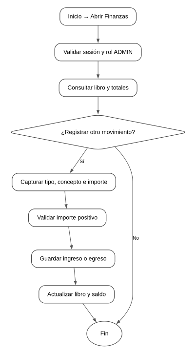

Secuencia principal del módulo. Las validaciones y transacciones se ejecutan en Express; Angular presenta el resultado.

#### Compras

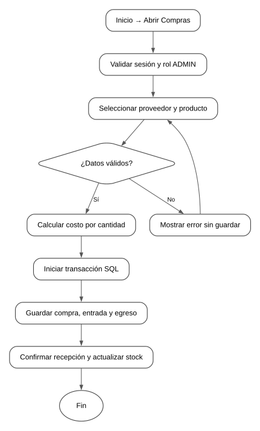

Secuencia principal del módulo. Las validaciones y transacciones se ejecutan en Express; Angular presenta el resultado.

#### Inventario

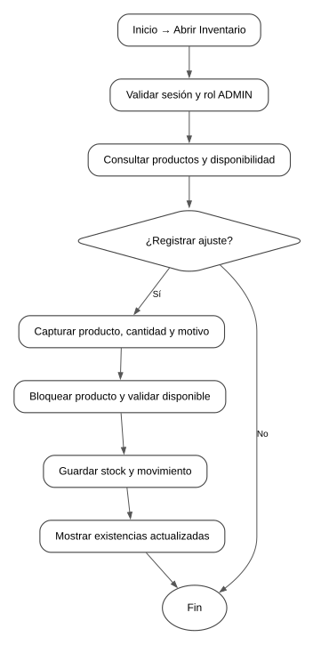

Secuencia principal del módulo. Las validaciones y transacciones se ejecutan en Express; Angular presenta el resultado.

#### RH

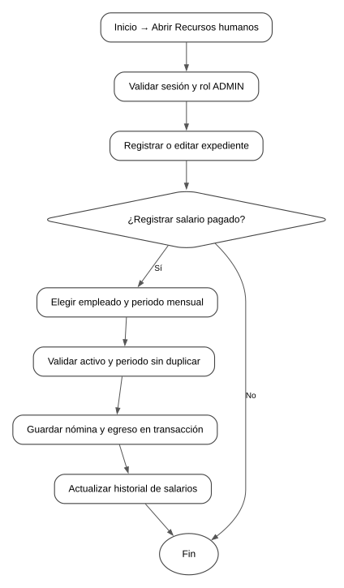

Secuencia principal del módulo. Las validaciones y transacciones se ejecutan en Express; Angular presenta el resultado.

#### General

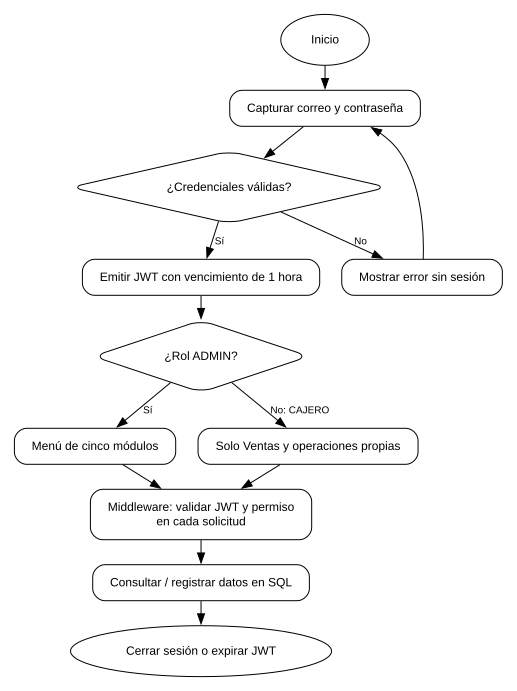

Secuencia principal del módulo. Las validaciones y transacciones se ejecutan en Express; Angular presenta el resultado.

#### Ventas

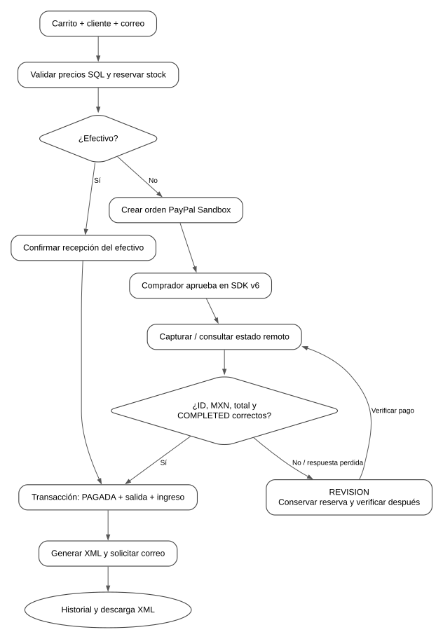

El navegador no confirma por sí solo el pago. Una respuesta incierta conserva la venta en revisión y no libera existencias automáticamente.

### Clases

#### Finanzas

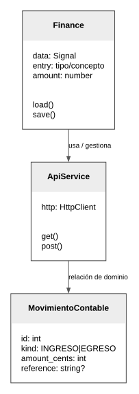

Las clases Angular corresponden al código. Las entidades de dominio son un modelo conceptual de las tablas SQL; el backend usa módulos y funciones, no clases ORM.

#### Compras

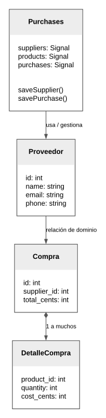

Las clases Angular corresponden al código. Las entidades de dominio son un modelo conceptual de las tablas SQL; el backend usa módulos y funciones, no clases ORM.

#### Inventario

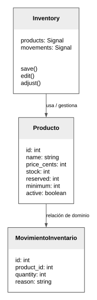

Las clases Angular corresponden al código. Las entidades de dominio son un modelo conceptual de las tablas SQL; el backend usa módulos y funciones, no clases ORM.

#### Ventas

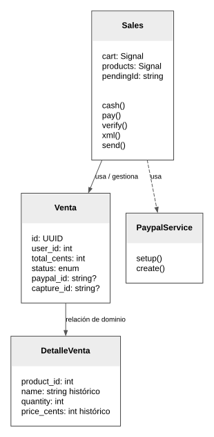

Las clases Angular corresponden al código. Las entidades de dominio son un modelo conceptual de las tablas SQL; el backend usa módulos y funciones, no clases ORM.

#### RH

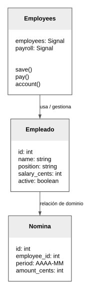

Las clases Angular corresponden al código. Las entidades de dominio son un modelo conceptual de las tablas SQL; el backend usa módulos y funciones, no clases ORM.

#### Transversal

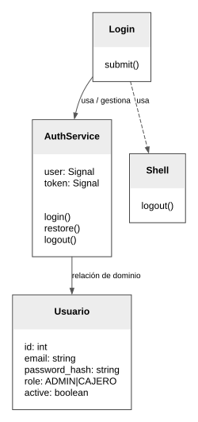

Las clases Angular corresponden al código. Las entidades de dominio son un modelo conceptual de las tablas SQL; el backend usa módulos y funciones, no clases ORM.

### Componentes

#### Finanzas

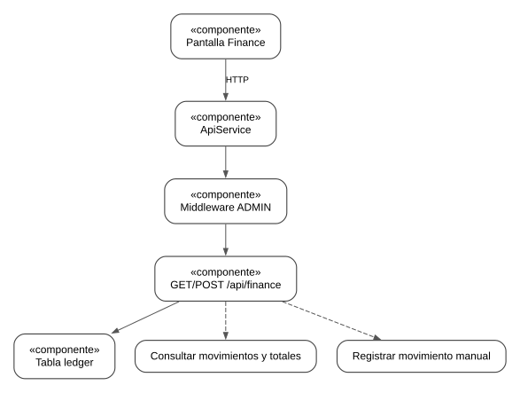

Separación de interfaz, servicio HTTP, autorización y persistencia. Las flechas representan dependencias de ejecución, no nuevas pantallas.

#### Compras

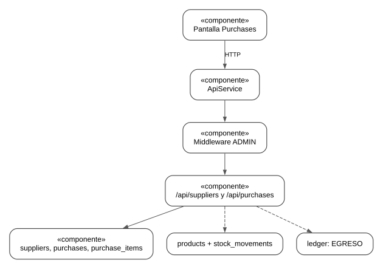

Separación de interfaz, servicio HTTP, autorización y persistencia. Las flechas representan dependencias de ejecución, no nuevas pantallas.

#### Inventario

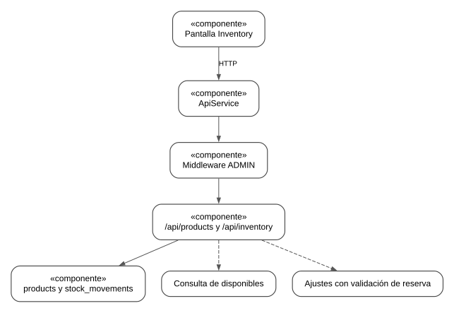

Separación de interfaz, servicio HTTP, autorización y persistencia. Las flechas representan dependencias de ejecución, no nuevas pantallas.

#### Ventas

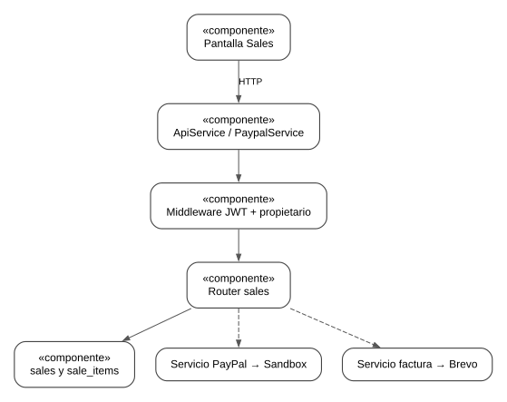

Separación de interfaz, servicio HTTP, autorización y persistencia. Las flechas representan dependencias de ejecución, no nuevas pantallas.

#### RH

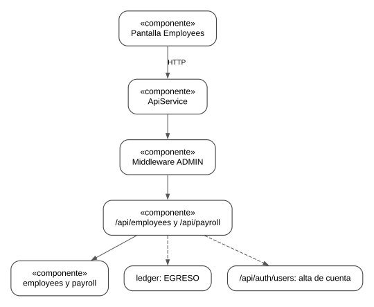

Separación de interfaz, servicio HTTP, autorización y persistencia. Las flechas representan dependencias de ejecución, no nuevas pantallas.

#### Transversal

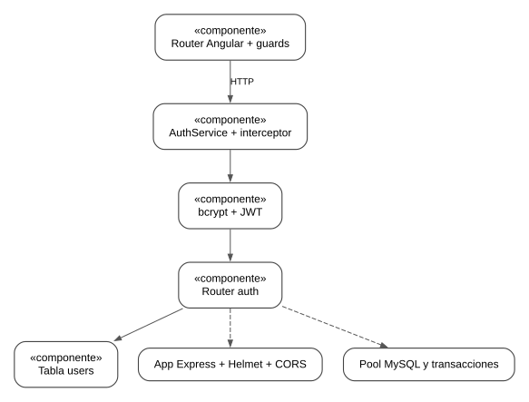

Separación de interfaz, servicio HTTP, autorización y persistencia. Las flechas representan dependencias de ejecución, no nuevas pantallas.

### Casos de uso

#### Finanzas

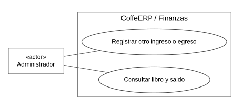

El administrador dispone de los cinco módulos. El cajero opera Ventas y solo sus propias ventas; los servicios externos requieren configuración.

#### Compras

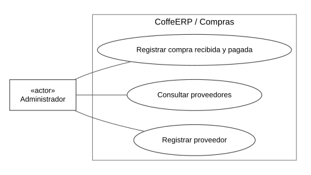

El administrador dispone de los cinco módulos. El cajero opera Ventas y solo sus propias ventas; los servicios externos requieren configuración.

#### Inventario

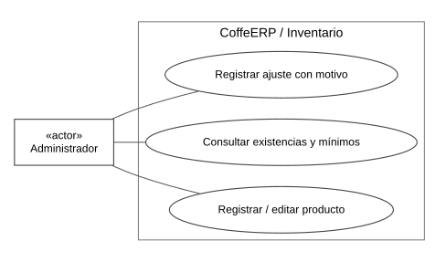

El administrador dispone de los cinco módulos. El cajero opera Ventas y solo sus propias ventas; los servicios externos requieren configuración.

#### Ventas

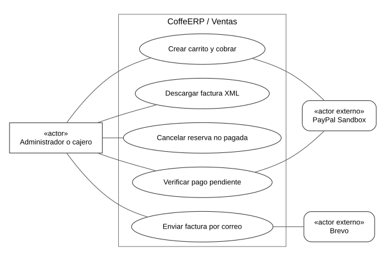

El administrador dispone de los cinco módulos. El cajero opera Ventas y solo sus propias ventas; los servicios externos requieren configuración.

#### RH

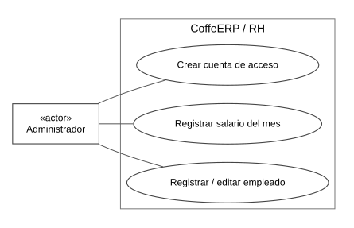

El administrador dispone de los cinco módulos. El cajero opera Ventas y solo sus propias ventas; los servicios externos requieren configuración.

#### Transversal

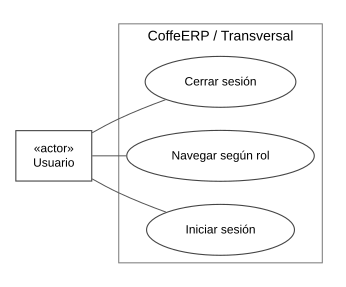

El administrador dispone de los cinco módulos. El cajero opera Ventas y solo sus propias ventas; los servicios externos requieren configuración.

### DER

#### Modelo relacional

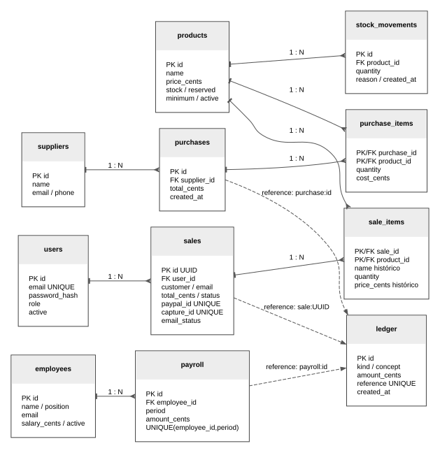

Claves PK/FK del esquema InnoDB. Las líneas punteadas de ledger son referencias lógicas únicas; no son claves foráneas. Las entidades y campos coinciden con sql/schema.sql.

### Mapa de Navegación

#### Navegación

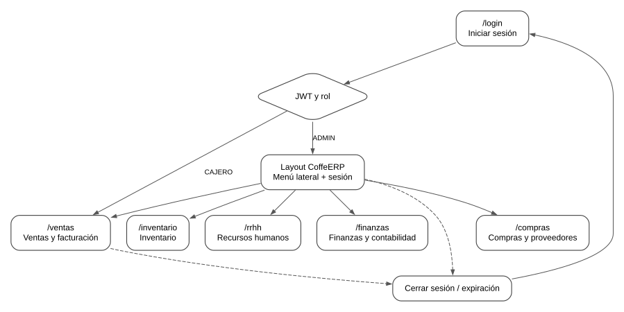

Una pantalla por módulo. Las acciones de registro, edición, pago y consulta permanecen dentro de cada pantalla; no se agregan dashboards.

## Maquetados

Los wireframes y mockups se encuentran en maquetados/.

## Repositorio

https://github.com/WakandianShield/CoffeERP-Examen

El proyecto se entrega en el repositorio CoffeERP-Examen y en ZIP.

## Evidencia

Ver 23300748_Evidencias_CoffeERP.pdf y evidencias/resultados.json.

## Conclusión

En esta versión se redujo la navegación de CoffeERP a cinco módulos que cubren las operaciones solicitadas para la cafetería. Se mantuvo la apariencia oscura del proyecto original y se concentraron los formularios e historiales en una pantalla por área, evitando agregar dashboards o procesos que no eran necesarios para el examen.

La relación entre compras, ventas, inventario y finanzas permite observar el resultado de cada operación. Una compra recibida incrementa existencias y registra un egreso; una venta pagada descuenta productos y crea un ingreso; los salarios registrados también afectan el libro de movimientos. El uso de SQL y transacciones conserva estos cambios después de cerrar el navegador y evita operaciones parciales.

La seguridad se implementó tanto en la navegación como en el servidor. Las contraseñas se guardan con hash, las sesiones vencen y el middleware revisa permisos antes de ejecutar las rutas. Las pruebas con el rol Cajero muestran que ocultar una opción del menú no es la única medida: el backend también rechaza operaciones administrativas.

Las pruebas externas confirmaron la orden PayPal Sandbox 9MT738004E0785006 y la captura 36T4764777771110X por $1.00 MXN, con estado COMPLETED en PayPal y PAGADA en SQL. La verificación repetida conservó un solo ingreso contable. Brevo registró la entrega de las dos facturas XML de prueba. La fuente de pago fue una tarjeta ficticia oficial de Sandbox; no se validó el inicio de sesión de la cuenta compradora y no se utilizó dinero real.

## Bibliografía

Angular. (s. f.). Components, dependency injection y HTTP client. https://angular.dev/guide/components y https://angular.dev/guide/http

Express. (s. f.). Using middleware y error handling. https://expressjs.com/en/guide/using-middleware.html y https://expressjs.com/en/guide/error-handling.html

MySQL. (s. f.). InnoDB transaction model. https://dev.mysql.com/doc/refman/8.4/en/innodb-transaction-model.html

PayPal Developer. (s. f.). Set up JavaScript SDK v6. https://developer.paypal.com/sdk/js/set-up/

PayPal Developer. (s. f.). Orders API integration. https://developer.paypal.com/api/rest/integration/orders-api

Brevo. (s. f.). Send a transactional email. https://developers.brevo.com/reference/send-transac-email

Auth0. (s. f.). node-jsonwebtoken. https://github.com/auth0/node-jsonwebtoken

Gallardo Ruvalcaba, S. (2026). CoffeERP. Repositorio de proyecto: https://github.com/WakandianShield/CoffeERP

Ponce Villalvazo, P. F. (2026). Consigna del examen de Programación Web II. Material de clase proporcionado por el alumno.

Material de apoyo del curso: 23300748_Examen_SistemaERP (1).pdf; local-repo-converted (6).md y (7).md; Autenticacion-Autorizacion_Angular-main.zip y apuntes de PayPal.

PayPal. (2026). Card testing. https://developer.paypal.com/sandbox-testing/card-testing

PayPal. (s. f.). Expanded Checkout Orders API use cases. https://developer.paypal.com/api/rest/integration/orders-api/api-use-cases/advanced/
